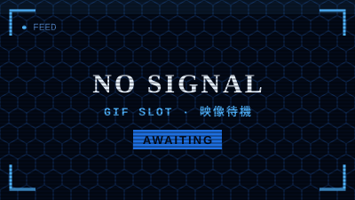
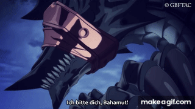
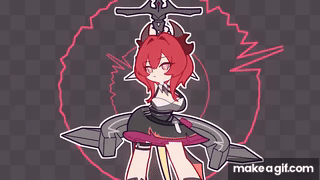
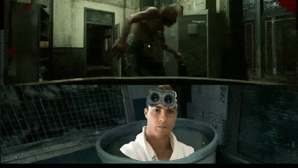

<!-- Replace YOUR_USERNAME everywhere with your new GitHub username -->
<!-->
<p align="center">
  
</p>

<p align="center">
  
  
  
</p>


## `01` ▸ PILOT DATA ⟨ 基本情報 ⟩

```diff
+ IDENT ........... Casper
+ ROLE ............ 3D ARTIST(noob) / GAME DEV HOBBYIST
+ BASE ............ MALAYSIA
+ CURRENT TASK .... Blender scenes, model kits & random Python scripts
+ OFF-DUTY ........ Music · Model kits · Drawing
- THREAT LEVEL .... LOW (mostly just rendering things at 3am)
```

> **SYSTEM LOG ›** This account is my hobby lab — renders, experiments, half-finished prototypes and everything in between.


## `02` ▸ OFF-DUTY ACTIVITIES ⟨ 趣味 ⟩

<!-- To add your own GIFs: put them in assets/gifs/ and change each src below,
     e.g. src="./assets/gifs/music.gif" -->

<table>
  <tr>
    <td align="center" width="33%">
      
      <br/><b>🎧 AUDIO SYNC</b>
      <br/><sub><code>LISTENING TO MUSIC</code></sub>
      <br/><sub>Headphones on, the world on mute.</sub>
    </td>
    <td align="center" width="33%">
      
      <br/><b>🔧 UNIT ASSEMBLY</b>
      <br/><sub><code>MODEL KITS</code></sub>
      <br/><sub>Sprues, nippers and way too many tiny parts.</sub>
    </td>
    <td align="center" width="33%">
      
      <br/><b>✏️ VISUAL OUTPUT</b>
      <br/><sub><code>DRAWING</code></sub>
      <br/><sub>Sketches, doodles, the occasional finished piece.</sub>
    </td>
  </tr>
</table>


## `03` ▸ SIMULATION ARCHIVE ⟨ 愛用ゲーム ⟩

<table>
  <tr>
    <td align="center" width="33%">
      
      <br/><b>GRANBLUE FANTASY</b>
      <br/>
      <br/><sub>Skyfarer since forever. The grind never ends.</sub>
    </td>
    <td align="center" width="33%">
      
      <br/><b>ARKNIGHTS</b>
      <br/>
      <br/><sub>Doctor on duty. Sanity always at zero.</sub>
    </td>
    <td align="center" width="33%">
      
      <br/><b>THE OUTLAST TRIALS</b>
      <br/>
      <br/><sub>Screaming with friends, professionally.</sub>
    </td>
  </tr>
</table>

```diff
! WARNING: Pilot may be unavailable during event periods and limited banners.
```


## `04` ▸ PYTHON LAB ⟨ 実験場 ⟩

> I love using Python to code random sh\*t. Some of it is useful. Most of it is not.

```python
class Yhchan:
    def __init__(self):
        self.language = "Python 🐍"
        self.projects = ["random scripts", "automation", "whatever idea hits at 2am"]
        self.status = "cooling down"

    def run(self, idea: str) -> str:
        return f"[SYS] '{idea}' deployed. Usefulness: questionable."

print(Yhchan().run("something cool"))
```


## `05` ▸ ARSENAL ⟨ 装備 ⟩

<p>
  
  
  
  
  
  
  
</p>

| MODULE | SYNC RATE |
| :-- | :-- |
| 3D Modelling & Rendering | `██████████░░` 83% |
| Animation & Retargeting  | `████████░░░░` 67% |
| Physics / Destruction FX | `███████░░░░░` 58% |
| Game Programming         | `██████░░░░░░` 50% |


## `06` ▸ ACTIVE OPERATIONS ⟨ 作戦 ⟩

| OP | DESCRIPTION | STATUS |
| :-- | :-- | :-: |
| **[project-one](https://github.com/YOUR_USERNAME/project-one)** | Short description of the project | 🟦 ACTIVE |
| **[project-two](https://github.com/YOUR_USERNAME/project-two)** | Short description of the project | 🔷 TESTING |
| **[project-three](https://github.com/YOUR_USERNAME/project-three)** | Short description of the project | ⬜ STANDBY |


## `07` ▸ TELEMETRY ⟨ 観測 ⟩

<p align="center">
  
  
</p>

<p align="center">
  
</p>


## `08` ▸ COMMS CHANNEL ⟨ 通信 ⟩

<p>
  <a href="https://github.com/YOUR_USERNAME"></a>
  <a href="https://www.artstation.com/YOUR_HANDLE"></a>
  <a href="https://YOUR_HANDLE.itch.io"></a>
</p>

```
> TRANSMIT ............ open to collabs on renders & game jams
> RESPONSE WINDOW ..... usually within a few cooldown cycles
```

<p align="center">
  
</p>
